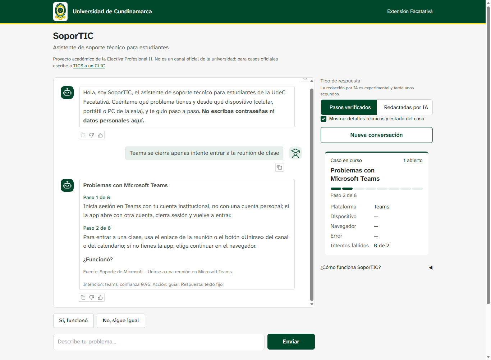
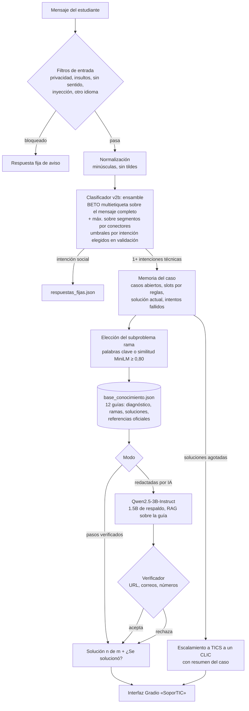
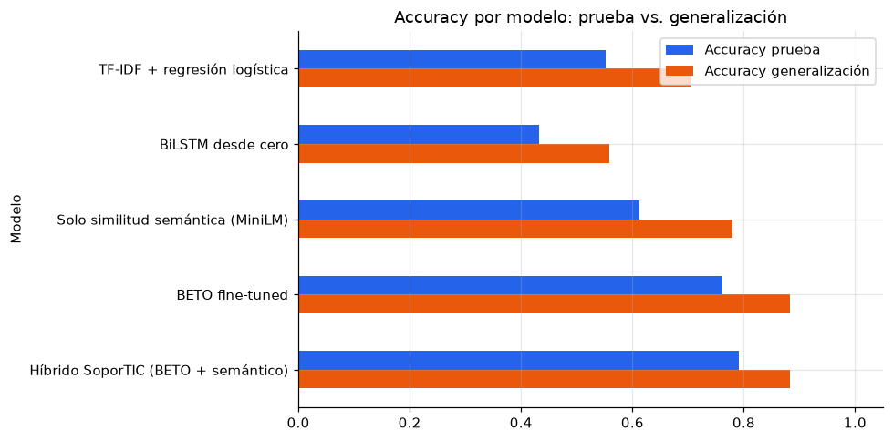

# SoporTIC

Asistente de mesa de ayuda (soporte técnico) con Transformers para estudiantes de la Universidad de Cundinamarca, sede Facatativá. Proyecto final de la Electiva Profesional II: Fundamentos de Deep Learning (aplicaciones de Deep Learning).

**Autores:** Jean Paul Miranda Díaz y Lina Tatiana Maldonado. **Docente:** Jorge Eduardo Mican. Universidad de Cundinamarca, sede Facatativá, 2026.

> Proyecto académico. No es un canal oficial de la universidad: los casos reales se atienden en la mesa de ayuda «TICS a un CLIC».



## Qué hace
- Reconoce **uno o varios problemas en el mismo mensaje** («olvidé la clave del correo y tampoco puedo subir el taller a Moodle») entre 17 intenciones: Moodle (acceso y entregas), correo institucional, restablecer contraseña, Wi-Fi de la sede, Teams, Office 365, instalar Python, Google Colab con GPU, plataforma académica, salas de cómputo, hablar con soporte y 5 sociales (saludo, despedida, agradecimiento, sobre el bot, fuera de dominio).
- Guía **una solución por turno** a partir de una base de conocimiento con fuentes oficiales, y **recuerda el caso** (plataforma, dispositivo, navegador, error, solución actual, intentos fallidos). Atiende seguimientos cortos («y en el portátil?», «no, sigue igual») y cambios de tema.
- Si las soluciones se agotan, **escala** a «TICS a un CLIC» con un resumen del caso.
- Filtra contraseñas y datos personales (los oculta y nunca los repite), insultos, texto sin sentido, inyección de instrucciones y mensajes en otro idioma. Los trámites de reglamento (homologaciones, notas, supletorios, becas) se remiten a la dependencia correspondiente.
- Dos modos de respuesta: **pasos verificados** (texto fijo de la guía) y **redactadas por IA** (Qwen2.5 reescribe la guía y un verificador rechaza datos que no estén en ella).
- Interfaz Gradio que funciona sin internet y en el celular.

## Arquitectura



Si el verificador rechaza la redacción de Qwen, se muestra el texto fijo de la guía.

El desarrollo se hizo por versiones, todas en un único notebook (`SoporTIC.py` ↔ `SoporTIC.ipynb`):

| Versión | Secciones | Contenido |
|---|---|---|
| v1 | 1–9 | Una intención: TF-IDF + regresión logística, BiLSTM desde cero, MiniLM, BETO *fine-tuned* e híbrido BETO + MiniLM; aumento de datos con retrotraducción y filtros anti-fuga. Congelada en `soportic/v1_congelada/`. |
| v2 | 10–14 | Multiintención: BETO multietiqueta (sigmoide + BCE), segmentación por conectores, *temperature scaling*. |
| v2b | 15–19 | Frases sintéticas de dos intenciones (concatenadas y de Qwen2.5-3B), negativos con conector; método final (ensamble) elegido por validación cruzada antes de evaluar la prueba. **Es el clasificador del bot.** |
| v3 / v4 | 20–23 | Memoria del caso, subproblemas, modo IA con verificador e interfaz Gradio. |
| Fase 5 | 24–26 | Batería de 254 casos, latencia, VRAM y evaluación humana. |

Diagrama para el informe: [figuras/fig_arquitectura_soportic.png](figuras/fig_arquitectura_soportic.png). Detalle de cada modelo (capas, parámetros, licencias): [docs/ARQUITECTURA_MODELOS.md](docs/ARQUITECTURA_MODELOS.md).

## Modelos
Ningún peso se incluye en el repositorio. Los modelos preentrenados se descargan de Hugging Face la primera vez (caché en `%USERPROFILE%\.cache\huggingface`); los ajustados se generan al ejecutar el notebook (cada carpeta de `soportic/modelo_*` tiene un `LEEME.md`).

| Modelo | Uso | Origen |
|---|---|---|
| BETO `dccuchile/bert-base-spanish-wwm-uncased` | Base de todos los clasificadores ajustados (v1, v2, v2b) | https://huggingface.co/dccuchile/bert-base-spanish-wwm-uncased |
| BETO multietiqueta v2b (ajustado) | Clasificador del bot | Se genera en las secciones 15–17 → `soportic/modelo_bert_multietiqueta_v2b/` |
| `sentence-transformers/paraphrase-multilingual-MiniLM-L12-v2` | Híbrido v1, controles de fuga, elección de subproblema | https://huggingface.co/sentence-transformers/paraphrase-multilingual-MiniLM-L12-v2 |
| `Qwen/Qwen2.5-3B-Instruct` | Modo IA y frases sintéticas de la v2b | https://huggingface.co/Qwen/Qwen2.5-3B-Instruct |
| `Qwen/Qwen2.5-1.5B-Instruct` | Respaldo del modo IA (`iniciar_soportic.bat 1.5B`) | https://huggingface.co/Qwen/Qwen2.5-1.5B-Instruct |
| `Helsinki-NLP/opus-mt-es-en` y `opus-mt-en-es` | Retrotraducción del aumento (solo si falta la caché) | https://huggingface.co/Helsinki-NLP |
| Amazon MASSIVE (es), espejo `mteb/amazon_massive_intent` | Ejemplos adicionales de fuera de dominio | https://huggingface.co/datasets/mteb/amazon_massive_intent |

Licencias de terceros: Qwen2.5-3B-Instruct usa la *Qwen Research License* (uso no comercial); el 1.5B, Apache-2.0; BETO se trata como CC BY 4.0; MASSIVE, CC BY 4.0. Detalle en [docs/ARQUITECTURA_MODELOS.md](docs/ARQUITECTURA_MODELOS.md). Las fuentes de la interfaz (Atkinson Hyperlegible) son OFL (`ui/fuentes/`).

## Datos
| Archivo | Contenido |
|---|---|
| `dataset_soporte.csv` | 442 frases propias: 17 intenciones × 26 (columnas `texto,intencion,origen`). Partición estratificada 70/15/15, semilla 42. |
| `frases_generalizacion.csv` | 68 frases aparte (4 por intención). |
| `frases_prueba_externa.txt` | 120 frases redactadas por otro asistente de IA: 90 de una intención y 30 de varias (`frase;intencion1\|intencion2`). |
| `*_multietiqueta.csv`, `guia_anotacion_multietiqueta.md` | Versión multietiqueta y su guía de anotación. |
| `base_conocimiento.json` | 12 guías técnicas (diagnóstico → ramas → soluciones con subpasos y referencias oficiales) y el contacto por defecto. `base_conocimiento_v3.json`: versión anterior, la usan las secciones v1–v2 para ser reproducibles. |
| `respuestas_fijas.json` | Respuestas de las intenciones sociales y de trámites. |
| `conversaciones_memoria*.json`, `bateria_soporte*.json`, `prueba_estres.json`, `tareas_evaluacion.csv` | Conjuntos de evaluación, escritos antes de ejecutar. Son casos de prueba redactados, no conversaciones reales; los «secretos» de la batería (claves, cédulas, correos) son ficticios. |
| `soportic/datos/` | Cachés (aumento de datos, generaciones de Qwen) y salidas por caso de cada evaluación. |

Los datos institucionales que no se pudieron confirmar quedan como `[COMPLETAR: ...]` en la base de conocimiento; el bot nunca los muestra: omite ese paso y remite a TICS a un CLIC.

## Resultados
Todas las cifras salen de los JSON de `soportic/` producidos por el notebook (ejecución final del 2026-11-15, RTX 5050 Laptop 8 GB). El resumen completo, con el archivo de origen de cada tabla, está en [RESULTADOS_FINALES_SOPORTE.md](RESULTADOS_FINALES_SOPORTE.md).

**Una intención (v1).** Fuente: `soportic/v1_congelada/resultados_soporte_v1.json`; externo: `soportic/resultados_soporte_v1_reejecucion.json`.

| Modelo | Accuracy prueba (67) | F1 macro prueba | Accuracy generalización (68) | Accuracy externa (90) |
|---|---|---|---|---|
| TF-IDF + regresión logística | 0,5522 | 0,5642 | 0,7059 | 0,7333 |
| BiLSTM desde cero | 0,4328 | 0,4311 | 0,5588 | 0,5889 |
| Solo similitud semántica (MiniLM) | 0,6119 | 0,6015 | 0,7794 | 0,8000 |
| BETO *fine-tuned* | 0,7612 | 0,7316 | 0,8824 | 0,8111 |
| Híbrido (BETO + MiniLM) | 0,7910 | 0,7811 | 0,8824 | 0,8111 |



**Multiintención (v2b, ensamble elegido por validación cruzada).** Fuente: `soportic/resultados_soporte_v2b.json`.

| Conjunto | n | Exact match | F1 micro |
|---|---|---|---|
| Validación cruzada, 5 particiones (media ± DE) | — | 0,6496 ± 0,0463 | 0,8279 ± 0,0404 |
| Prueba (67 originales + 120 sintéticas) | 187 | 0,6578 | 0,8293 |
| Generalización | 68 | 0,9118 | — |
| Externo completo (evaluado una sola vez) | 120 | 0,8000 | 0,8600 |
| Externo, una intención | 90 | 0,8444 | 0,8370 |
| Externo, 30 naturales de varias intenciones | 30 | 0,6667 | 0,8966 |

**Memoria del caso (v4).** Fuente: `soportic/resultados_soporte_v4.json`; 30 conversaciones, 104 turnos.

| Métrica | Con memoria | Sin memoria |
|---|---|---|
| Acción correcta por turno | 0,9712 | 0,3558 |
| Seguimientos bien resueltos (67) | 0,9104 | 0,0000 |
| Conversaciones resueltas o bien escaladas (30) | 0,9000 | 0,0000 |

**Sistema completo.** Fuente: `soportic/resultados_soporte_final.json`.
- Batería de 254 casos: 213 pasan, 10 aclaran, 31 fallan (83,9 %); 0 fallos funcionales. Privacidad, inyección de instrucciones, `[COMPLETAR]` nunca mostrado y modo IA con verificador: 100 %.
- Latencia (30 mensajes): modo fijo, media 0,039 s; modo IA (Qwen2.5-3B, bf16), media 1,381 s, p95 4,785 s, máximo 5,417 s. Pico de VRAM: 6,98 GB.

**Pruebas unitarias.** `tests/test_memoria.py` (memoria del caso, slots y filtros, en CPU con un clasificador sustituto de palabras clave): `157 passed in 28.18s` (corrida del 2026-11-23).

**Evaluación humana:** pendiente; `tareas_evaluacion.csv` lo llenan los autores.

## Instalación y ejecución

### Requisitos
- Python 3.11 (probado con 3.11.9).
- PyTorch con CUDA (probado con torch 2.11.0+cu128 en una RTX 5050 Laptop de 8 GB; las GPU Blackwell necesitan CUDA 12.8 o superior). Sin GPU funciona, pero el entrenamiento y el modo IA son muy lentos.
- Unos 15 GB libres: 12 GB de caché de Hugging Face (BETO 0,8 GB, MiniLM 0,5 GB, Qwen 3B 5,8 GB, Qwen 1.5B 2,9 GB, MarianMT 1,2 GB) y 2,6 GB de los seis BETO ajustados de `soportic/` (440 MB cada uno). Medido en el equipo de desarrollo.

### Local (Windows, PowerShell)
```powershell
git clone <URL_DEL_REPOSITORIO> SoporTIC
cd SoporTIC
python -m venv .venv --system-site-packages     # hereda torch del Python global
.\.venv\Scripts\Activate.ps1
python -c "import torch; print(torch.__version__, torch.cuda.is_available())"
pip install -r requirements.txt
python -m ipykernel install --user --name soportic --display-name "SoporTIC"
```

Si el Python global no tiene torch, instálelo antes desde https://pytorch.org/get-started/locally/ con la versión de CUDA de su GPU.

**1. Entrenar y evaluar (genera los modelos de `soportic/`).** Tarda entre 45 y 65 min en la RTX 5050 con las cachés del aumento y de Qwen (`RESULTADOS_FINALES_SOPORTE.md`, sección 7).
```powershell
$env:SOPORTIC_USAR_GPT = "1"   # "0" desactiva el modo IA (Qwen)
$env:SOPORTIC_GRADIO = "0"     # "0" no lanza la interfaz al final
jupyter nbconvert --to notebook --execute SoporTIC.ipynb --output SoporTIC.ipynb --ExecutePreprocessor.timeout=-1 --ExecutePreprocessor.kernel_name=soportic
```

**2. Usar el bot sin reentrenar.** Doble clic en `iniciar_soportic.bat`, o:
```powershell
.\iniciar_soportic.bat          # Qwen2.5-3B
.\iniciar_soportic.bat 1.5B     # respaldo si el modo IA va lento o falta VRAM
# equivalente con el .venv activo:
python iniciar_soportic.py
```
Carga `soportic/modelo_bert_multietiqueta_v2b/`, prueba tres mensajes y abre http://127.0.0.1:7860 (o el siguiente puerto libre). Funciona sin internet: si un modelo no está en la caché, ejecute una vez con `$env:SOPORTIC_EN_LINEA = "1"`. Variables: `SOPORTIC_USAR_GPT=0` (sin modo IA), `SOPORTIC_GENERADOR=1.5B`, `SOPORTIC_SIN_NAVEGADOR=1`, `SOPORTIC_SOLO_COMPROBAR=1` (solo la comprobación, sin interfaz).

### Google Colab (GPU T4)
1. Crear el paquete de datos en local: `python herramientas/crear_zip_colab.py` (genera `soportic_datos.zip`, que no se sube al repositorio).
2. Abrir `SoporTIC.ipynb` en Colab con GPU T4 y subir `soportic_datos.zip` a `MyDrive/SoporTIC/` (o subirlo cuando la segunda celda lo pida).
3. Ejecutar todo. En la T4, BETO usa fp16 y Qwen fp32; si Qwen 3B no cabe, se usa el 1.5B. La interfaz se abre con un enlace público de Gradio (`share=True` en Colab).

Recetas para cambiar la base de conocimiento, el dataset, el modelo generador o la interfaz: [GUIA_CAMBIOS.md](GUIA_CAMBIOS.md).

## Estructura del repositorio
```
SoporTIC.py / SoporTIC.ipynb   notebook (fuente: el .py en formato percent, emparejado con jupytext)
iniciar_soportic.py / .bat     lanzador del bot con los modelos guardados
*.csv, *.json, *.txt (raíz)    datos fuente y conjuntos de evaluación
herramientas/                  scripts de datos, batería, figuras, zip de Colab y evaluación humana
tests/                         pruebas unitarias de la memoria del caso (CPU)
soportic/                      resultados (JSON), cachés, figuras del notebook, recursos de la UI y LEEME de los modelos
figuras/                       figuras del informe y capturas de la interfaz
docs/                          arquitectura de los modelos, resumen de decisiones, diagnóstico de latencia
ui/                            logo y fuentes locales de la interfaz
DECISIONES.md                  decisiones de diseño y evaluación (citadas por número en los resultados)
DEMO_SUSTENTACION.md           guion de la demo en vivo
RESULTADOS_FINALES_SOPORTE.md  todas las cifras con su archivo de origen
```

## Limitaciones
Con las cifras que las respaldan en [RESULTADOS_FINALES_SOPORTE.md](RESULTADOS_FINALES_SOPORTE.md), sección 10:
1. **Dataset pequeño:** 26 frases por intención; cada error en la prueba (67 frases) mueve la accuracy 1,5 puntos y la validación cruzada de BETO varía ± 0,04–0,05.
2. **Mensajes de dos intenciones:** el ensamble acierta 0,54 ± 0,06 en validación cruzada (exactitud en 2+ intenciones) y 20 de 30 en los mensajes naturales del externo; la multiintención de la batería pasa 13 de 20.
3. **Datos sintéticos:** las 120 frases de dos intenciones de la prueba son sintéticas y la v2b se diseñó después de ver la prueba de la v2; la evidencia más cercana al uso real es el externo.
4. **Trámites:** solo 2 de 8 casos de trámites de la batería reciben la respuesta correcta.
5. **Calibración:** el ECE de prueba (0,1442) duplica el de validación (0,0657) y el *temperature scaling* casi no lo cambia (T = 1,0461).
6. **Modo IA y VRAM:** con Qwen 3B el pico es 6,98 GB en una GPU de 8 GB; si otro programa usa la GPU, la respuesta pasa a 20–40 s. El verificador solo controla URL, correos y números.
7. **Filtros simples:** el filtro de idioma solo reconoce inglés; entradas como «a» o «lorem ipsum» se responden como despedida.
8. **Dependencia de la primera clasificación:** si el primer mensaje se clasifica mal, la memoria sigue el caso equivocado (3 de 30 conversaciones).
9. **Datos institucionales incompletos:** la base de conocimiento conserva marcadores `[COMPLETAR]`.
10. **Evaluación humana pendiente.**

## Licencia
Código y datos propios bajo licencia MIT ([LICENSE](LICENSE)). Los modelos y conjuntos de terceros conservan sus licencias (sección «Modelos»). El logo de la Universidad de Cundinamarca (`ui/logo_udec.png`) pertenece a la universidad y no está cubierto por la licencia MIT.
